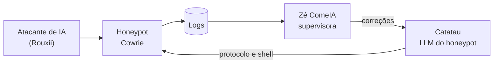

<h1 align="center">José Renato Araújo Pereira</h1>

  Engenharia de Computação · CEFET/RJ 
  Desenvolvimento · Dados · Redes · Segurança · <b>LLMs</b>

  
  
  

 

Estudante de Engenharia de Computação em busca de estágio. Venho estudando, com muito interesse, desenvolvimento de software, dados, redes, segurança da informação e modelos de linguagem (LLMs), e transformo o que aprendo em projetos que funcionam.

## Em destaque: iniciação científica

**Honeypots adaptativos contra atacantes baseados em LLM.** Um honeypot SSH cujas respostas são geradas por LLMs e que aprende sozinho o que o denuncia. Duas IAs trabalham em ciclo fechado: o **Catatau** controla o honeypot nas camadas de protocolo e de shell, e a **Zé ComeIA** analisa os logs e devolve correções.

- **Modelos locais** servidos com Ollama, comparando Llama 3.2 3B, Qwen3 e modelos de 7 a 14 bilhões de parâmetros quantizados
- **Fine-tuning com QLoRA** para especializar um modelo pequeno, e uma família de Catatau, um por protocolo
- **Avaliação** com atacantes de IA publicados em pesquisa, medindo a taxa de detecção ao longo dos ciclos

 

## Projetos

<table>
  <tr>
    <td width="50%" valign="top">
      <h3><a href="https://github.com/JoseRenato21/movie-etl-pipeline">movie-etl-pipeline</a></h3>
      Pipeline ELT em arquitetura medalhão (Bronze, Silver e Gold), com transformações em dbt e testes de qualidade dos dados.  
      
      
      
      
    </td>
    <td width="50%" valign="top">
      <h3><a href="https://github.com/JoseRenato21/Projeto_Portal_Academico">Projeto_Portal_Academico</a></h3>
      Gestão de cursos, turmas, inscrições e notas, com as regras de negócio em triggers do banco, API em camadas e interface em React.  
      
      
      
    </td>
  </tr>
  <tr>
    <td width="50%" valign="top">
      <h3><a href="https://github.com/JoseRenato21/booking-ddd-clean-arch-python">booking-ddd-clean-arch-python</a></h3>
      Reservas de hotel com Domain-Driven Design e Clean Architecture, com regras protegidas no domínio e 75 testes.  
      
      
      
    </td>
    <td width="50%" valign="top">
      <h3><a href="https://github.com/JoseRenato21/Jogo_Arkanoid_Assembly_Simp3">Jogo_Arkanoid_Assembly_Simp3</a></h3>
      Jogo de quebrar blocos inteiro em assembly, com interrupções, colisão e controle de memória em baixo nível.  
      
    </td>
  </tr>
  <tr>
    <td colspan="2" valign="top">
      <h3><a href="https://github.com/JoseRenato21/Puro-Malte-Estudos">Puro-Malte-Estudos</a></h3>
      Caderno de estudos de C, de variáveis a ponteiros, recursão e arquivos, com um exemplo compilável para cada tópico.  
      
    </td>
  </tr>
</table>

  
  

## Tecnologias

<table>
  <tr>
    <td width="170" valign="top"><b>LLMs</b></td>
    <td>
      
      
      
      
      
    </td>
  </tr>
  <tr>
    <td width="170" valign="top"><b>Dados</b></td>
    <td>
      
      
      
      
      
      
      
    </td>
  </tr>
  <tr>
    <td width="170" valign="top"><b>Desenvolvimento</b></td>
    <td>
      
      
      
      
      
      
      
      
    </td>
  </tr>
  <tr>
    <td width="170" valign="top"><b>Redes</b></td>
    <td>
      
      
      
      
      
      
      
    </td>
  </tr>
  <tr>
    <td width="170" valign="top"><b>Segurança</b></td>
    <td>
      
      
      
      
      
      
    </td>
  </tr>
</table>

## Experiência e formação

**BTG Pactual · Summer Job em Tecnologia** (fev a jun de 2025). Automação da coleta de dados da B3, ingestão em data lake na AWS com consulta em SQL pelo Athena, aplicações em Python e React publicadas na Azure.

**CEFET/RJ · Engenharia de Computação** (2024.1 a 2028.2). Participação no CTF do CEFET/RJ.

**Certificações:** Fortinet NSE 1 e NSE 2 · Cisco CCNA em preparação (prova prevista para fevereiro de 2027)
